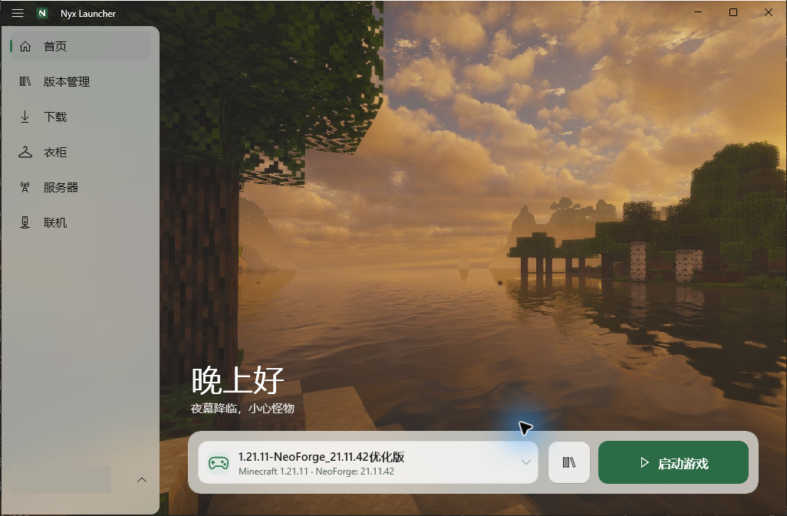

# Nyx Launcher

**在 Windows 上安装、管理与启动 Minecraft Java 版。**

原生 WinUI 3 界面 · 多版本管理 · 模组下载

[下载发布版](https://github.com/yan5236/Nyx-Launcher/releases/latest) · [功能一览](#功能一览) · [开发指南](docs/development.md)

首页实机截图，界面随开发持续调整。

## 功能一览

- **安装与启动** — 下载原版游戏，选配 Forge、Fabric 或 NeoForge，自动补齐游戏资源与运行依赖。
- **管理版本** — 切换游戏目录，搜索本地版本，更改名称与图标，按版本隔离存档和模组。
- **选择账户** — 支持微软账户、离线账户，以及 LittleSkin 等兼容 Yggdrasil 的外置账户。
- **下载资源** — 搜索 Modrinth 模组、资源包、光影和数据包，选择版本或存档安装，也可拖入本地资源。
- **导入整合包** — 在线安装或导入 Modrinth、MCBBS、MultiMC 格式的整合包。
- **管理 Java 与下载** — 扫描、导入和安装 Java，切换官方或镜像源，暂停、继续和取消下载任务。
- **自定义首页与手动更新** — 更换或移除首页图片；查看新版本的更新说明，确认后通过下载任务更新，下次启动生效。

> 当前仍在开发中。

## 开始使用

需要 Windows x64。从 [GitHub Releases](https://github.com/yan5236/Nyx-Launcher/releases) 下载 `NyxLauncher.exe`，保留文件名并放到有写入权限的目录后运行；发布版包含 .NET 和 Windows App SDK 运行时，无需另装。首次运行会将程序依赖解压到缓存目录。

首次使用先阅读并确认[用户协议](USER_AGREEMENT.md)和[隐私协议](PRIVACY.md)，添加账户，在「下载 → 游戏」安装一个版本，再回到首页选择版本并启动。默认游戏目录和自动安装的 Java 位于 EXE 旁边，用户配置保存在 `%LOCALAPPDATA%/NyxLauncher`。

在「设置 → 关于 → 检查更新」查看版本与更新说明。确认更新后会创建下载任务，完成后不会主动关闭当前窗口，下次启动使用新版；默认不自动检查或安装自身更新。

源码构建、微软公共客户端配置及 `v*` Tag 自动打包方式见[开发与发布指南](docs/development.md)。正式发布产物会在相应 Tag 的 Actions 成功后提供。

## 文档

从[协作文档索引](docs/README.md)进入，包含当前功能、模块职责、认证配置、资源安装和验证方法。
