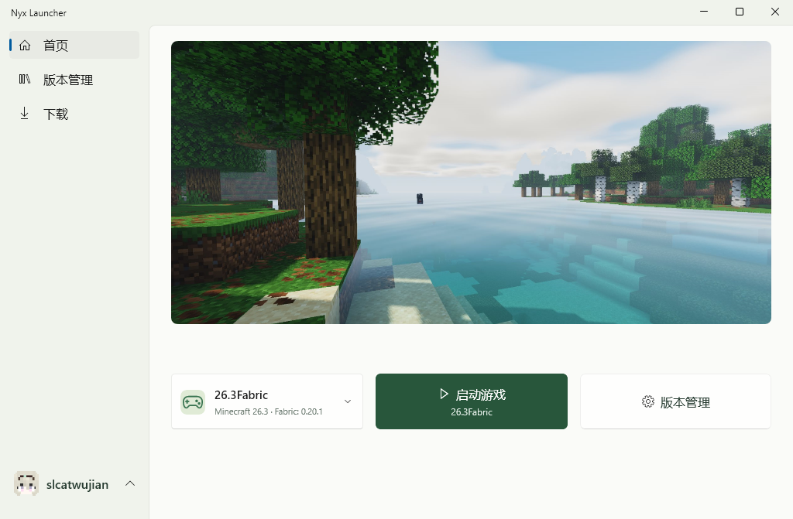

# Nyx Launcher

**在 Windows 上安装、管理与启动 Minecraft Java 版。**

原生 WinUI 3 界面 · 多版本管理 · 模组下载

[开始使用](#开始使用) · [功能一览](#功能一览) · [开发指南](docs/development.md)

首页实机截图，界面随开发持续调整。

## 功能一览

- **安装与启动** — 下载原版游戏，选配 Forge、Fabric 或 NeoForge，自动补齐游戏资源与运行依赖。
- **管理版本** — 切换游戏目录，搜索本地版本，更改名称与图标，按版本隔离存档和模组。
- **选择账户** — 支持微软账户、离线账户，以及 LittleSkin 等兼容 Yggdrasil 的外置账户。
- **下载资源** — 搜索 Modrinth 模组、资源包、光影和数据包，选择版本或存档安装，也可拖入本地资源。
- **导入整合包** — 在线安装或导入 Modrinth、MCBBS、MultiMC 格式的整合包。
- **管理 Java 与下载** — 扫描、导入和安装 Java，切换官方或镜像源，暂停、继续和取消下载任务。

> 当前仍在开发中。

## 开始使用

当前提供源码构建方式，需要 Windows x64。SDK 要求、微软登录配置及构建命令统一见[开发指南](docs/development.md)。

进入启动器后，添加账户，在「下载 → 游戏」安装一个版本，再回到首页选择版本并启动。

## 文档

从[协作文档索引](docs/README.md)进入，包含当前功能、模块职责、认证配置、资源安装和验证方法。
